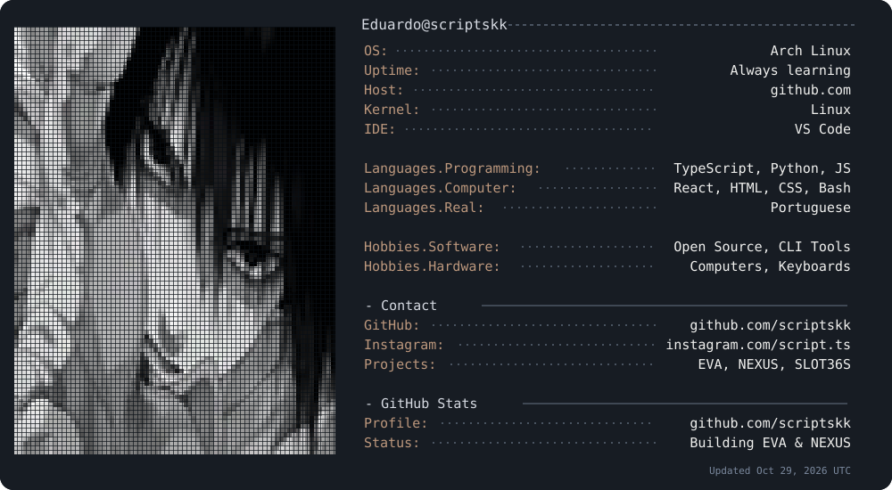

<!-- Perfil de Eduardo / scriptskk — inspirado na estrutura visual de Xensen008. -->

 

<!-- PROFILE CARD: SVG references the CURRENT GitHub profile photo by account ID. -->
<picture>
  <source media="(prefers-color-scheme: dark)" srcset="./assets/profile-dark.svg">
  <source media="(prefers-color-scheme: light)" srcset="./assets/profile-light.svg">
  
</picture>

<!-- GitHub may block remote images embedded inside SVG. This avatar is a reliable HTML fallback. -->

<picture>
  <source media="(prefers-color-scheme: dark)" srcset="https://raw.githubusercontent.com/scriptskk/scriptskk/output/github-contribution-grid-snake-dark.svg">
  <source media="(prefers-color-scheme: light)" srcset="https://raw.githubusercontent.com/scriptskk/scriptskk/output/github-contribution-grid-snake.svg">
  
</picture>

<b>About me · Technologies · Projects</b>

### About me
- 💻 Web developer passionate about interactive interfaces.
- 🤖 Building **EVA**, my personal voice assistant.
- 🖥️ **NEXUS** — dedicated Arch Linux server for EVA.
- 🐧 Open-source, Linux and automation enthusiast.

### Tech stack

### Projects
- **EVA** — Personal voice assistant and automation.
- **NEXUS** — Linux infrastructure for EVA.
- **SLOT36S** — Handheld interface customization.

